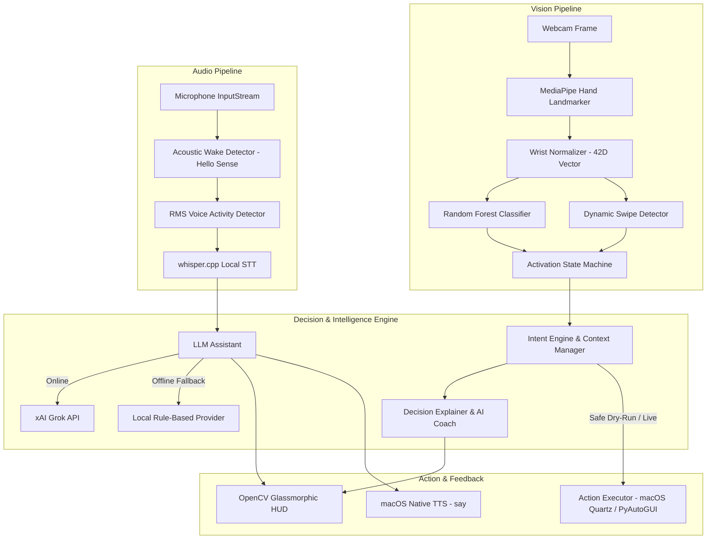

# IntentSense — Vision & Voice Multimodal AI Assistant

[](https://github.com/mitsocswaroopjadhav-star/hand-gesture-recognition-/actions/workflows/tests.yml)
[-blue.svg)](https://www.apple.com/macos/)
[](https://www.python.org/)

**IntentSense** is a multimodal, real-time hand-gesture and conversational voice assistant engineered natively for macOS (optimized for Apple Silicon M-series). Built on top of MediaPipe Tasks, scikit-learn Random Forests, on-device `whisper.cpp` Speech-to-Text, and optional xAI Grok conversational intelligence (with legacy Gemini compatibility), IntentSense enables intuitive, zero-touch control over your media, presentations, and daily workflows.

---

## 🌟 Key Features

### 1. Vision & Gesture Recognition Pipeline (Phases 1 & 2)
- **High-Accuracy Pose Classification**: Recognizes core gestures (`OpenPalm`, `Fist`, `Pointing`, `ThumbsUp`, `ThumbsDown`, `Peace`) with **99.60% accuracy** on a 251-sample held-out test split (out of 1,251 total samples).
- **Wrist-Relative Geometric Normalization**: Landmark coordinates are translated relative to wrist landmark 0 and scaled by palm span, ensuring translation and scale invariance across varying camera distances and hand positions within the frame.
- **Intentional State Machine**: Prevents accidental triggers via a deliberate 1.0s `OpenPalm` hold-to-unlock mechanism.
- **Dynamic Swipes & Inactivity Locking**: High-velocity horizontal swipes (`Swipe Left`, `Swipe Right`) for rapid media/slide navigation; automatically locks into a safe state after 30 seconds of inactivity.

### 2. Multi-Context Action Execution (Phase 3)
- **Media Mode**: Touchless control over Play/Pause (Fist), Volume Up (Thumbs Up), Volume Down (Thumbs Down), Next Track (Pointing / Swipe Right), and Previous Track (Peace / Swipe Left).
- **Presentation Mode**: Start/Stop slideshow (Fist), Next Slide (Pointing / Swipe Right), Previous Slide (Peace / Swipe Left), Zoom In (Thumbs Up), and Zoom Out (Thumbs Down).
- **Safe DRY-RUN Default**: Emits visual heads-up display (HUD) feedback without modifying system state. Live OS actions require explicit `--live` opt-in.
- **Typed Natural Language Commands**: Parse and validate user typed text commands against intent safety gates.

### 3. Touchless AI Coaching & Practice Mode (Phase 4)
- **Interactive Onboarding**: Step-by-step guidance designed to calibrate user hand size and introduce unlock holds.
- **Adaptive Threshold Policy**: Automatically adjusts confidence barriers based on lighting and temporal stability.
- **Live Struggle Detection**: Evaluates hesitation or hold deficits, offering real-time ergonomic HUD toasts.

### 4. Acoustic Voice Wake-Word Detection (Phase 5)
- **Local Wake-Word**: Listens continuously for **"Hello Sense"** using lightweight on-device acoustic RMS and Zero Crossing Rate (ZCR) syllable analysis.
- **Zero Cloud Leakage**: Audio is processed entirely in memory inside a circular buffer; raw audio is never logged or stored.

### 5. On-Device Speech Recognition & Multi-Turn AI Assistant (Phases 6 & 7)
- **Offline Whisper STT**: Transcribes questions locally using `whisper.cpp` and `ggml-base.en.bin` with Apple Silicon NEON & Accelerate BLAS acceleration.
- **Dynamic Voice Activity Detection (VAD)**: Listens naturally until the user finishes speaking (1.2s trailing silence cutoff), accommodating variable-length questions up to a 30s safety ceiling.
- **Dual AI Provider Architecture**:
  - **Online**: xAI Grok (`grok-4.7`) for general-purpose and technical conversational assistance. `XAI_API_KEY` selects Grok; legacy Gemini remains supported when no xAI key is configured.
  - **Offline Fallback**: Deterministic rule-based expert system answering all questions regarding IntentSense features, custom gestures, and locked states when offline.
- **Spoken AI Audio Responses**: Uses native macOS `/usr/bin/say` for smooth, non-blocking audio answers, with automatic microphone suppression during playback to prevent self-triggering.

---

## 🏗️ System Architecture



---

## 📊 Measured Evaluation & Accuracy

The underlying Random Forest gesture classification model was evaluated using a 20% stratified train/test split:
- **Dataset Size**: **1,251 samples** across 6 core classes (`Fist`, `OpenPalm`, `Peace`, `Pointing`, `ThumbsDown`, `ThumbsUp`).
- **Test Set**: **251 held-out samples** (`test_size=0.2, random_state=42, stratify`).
- **Test Accuracy**: **99.60%** (250/251 correct predictions).
- **Feature Dimensionality**: 42 normalized float coordinates (21 hand joints $\times$ 2D).

---

## 💻 Supported Hand Gestures

| Gesture | Media Context | Presentation Context | Custom Context |
| :--- | :--- | :--- | :--- |
| **Open Palm** | Unlock System (Hold 1.0s) | Unlock System (Hold 1.0s) | Unlock System (Hold 1.0s) |
| **Thumbs Up** | Volume Up | Zoom In | Configurable |
| **Thumbs Down** | Volume Down | Zoom Out | Configurable |
| **Pointing** | Next Track | Next Slide | Configurable |
| **Peace** | Previous Track | Previous Slide | Configurable |
| **Fist** | Play / Pause | Start / Stop Slideshow | Configurable |
| **Swipe Left** | Previous Track | Previous Slide | Configurable |
| **Swipe Right** | Next Track | Next Slide | Configurable |

---

## 🚀 Quick Start (Development)

### 1. Prerequisites
- macOS 12.0+ (Tested on macOS 14+ / Apple Silicon M-Series).
- Python 3.10 – 3.13.
- Webcam and microphone.

### 2. Installation
```bash
# Clone the repository
git clone https://github.com/mitsocswaroopjadhav-star/hand-gesture-recognition-.git
cd hand-gesture-recognition-

# Create virtual environment
python3 -m venv venv
source venv/bin/activate

# Install dependencies
pip install -r requirements.txt
```

### 3. Setup Local Speech Recognition (Optional for Voice Features)
```bash
# Downloads and compiles whisper.cpp and fetches the ggml-base.en.bin model (~141 MB)
bash scripts/setup_whisper.sh
```

### 5. Configure Grok Online AI (Optional)

Create an API key in the [xAI Console](https://console.x.ai/). For the installed macOS app, store it in the user-only configuration file:

```bash
mkdir -p "$HOME/Library/Application Support/IntentSense"
nano "$HOME/Library/Application Support/IntentSense/.env"
```

Add the following lines, replacing the placeholder with your key:

```dotenv
XAI_API_KEY=your_xai_api_key
XAI_MODEL=grok-4.7
```

Save the file, then restrict access:

```bash
chmod 600 "$HOME/Library/Application Support/IntentSense/.env"
```

Restart IntentSense. Its startup status should show `ONLINE (Grok)`. The API key is read locally and is not part of the app bundle or Git repository. xAI API usage may require account credits.

### 4. Running the Application
```bash
# 1. Run in Safe DRY-RUN mode (Default: visual feedback only, no OS actions executed)
python app.py

# 2. Run with Voice Wake-Word and Local STT enabled
python app.py --voice

# 3. Run with Live OS actions enabled (controls system volume, slides, etc.)
python app.py --live --voice

# 4. Run with optional Grok online AI key (configure XAI_API_KEY first)
python app.py --voice

# 5. Run headless component orchestration smoke test
python app.py --smoke
```

---

## 📦 Standalone macOS Application (`IntentSense.app`)

IntentSense can be compiled into a standalone macOS Application bundle (`IntentSense.app`) for Apple Silicon ARM64 using PyInstaller:

### Build the Application
```bash
# Install packaging requirements
pip install -r requirements-build.txt

# Run the automated build script
bash scripts/build_macos_app.sh
```

The compiled application bundle will be created at `dist/IntentSense.app`, along with a distributable archive `dist/IntentSense-macos-arm64.zip`.

### macOS Permissions
When launching `IntentSense.app` on macOS, grant the following permissions when prompted:
1. **Camera**: Required for hand landmark tracking via OpenCV/MediaPipe (`NSCameraUsageDescription`).
2. **Microphone**: Required for "Hello Sense" wake-word detection and query capture (`NSMicrophoneUsageDescription`).
3. **Accessibility & Automation** *(Only required for `--live` mode)*:
   - Navigate to **System Settings > Privacy & Security > Accessibility** and ensure IntentSense or your terminal is toggled on.
   - Navigate to **System Settings > Privacy & Security > Automation** to allow media key simulations.

---

## 🔒 Privacy & User Data

- **Zero Cloud Vision Data**: Video frames and biometric vectors are processed in RAM and discarded immediately.
- **Anonymous Public Dataset**: `dataset/gestures.csv` contains only anonymous mathematical coordinate offsets (42 normalized float values relative to wrist joint landmark 0) across 1,251 samples. It contains zero raw camera frames, images, video, biometric identity markers, or personal identifiable data, and is approved for open training and reproducibility.
- **Persistent User Data**: User custom gestures, settings, and logs are saved exclusively in:
  `~/Library/Application Support/IntentSense/custom_gestures.json`
  The application bundle itself remains strictly read-only.
- **Secure Fallback**: If Grok (or legacy Gemini) encounters authentication errors, rate limits, or network timeouts, IntentSense immediately falls back to its offline rule engine without exposing keys or interrupting the camera loop.

---

## 🧪 Testing

IntentSense includes a comprehensive test suite of 335+ unit and integration tests:

```bash
# Run all unit tests headlessly
MPLCONFIGDIR=/tmp/matplotlib python -m unittest discover -s . -p "test_*.py"

# Run voice conversation and assistant tests specifically
python -m unittest test_voice_conversation.py

# Run touchless onboarding tests
python -m unittest test_touchless_onboarding.py
```

---

## 📁 Repository Structure

```text
hand-gesture-recognition-/
├── .github/workflows/      # Automated CI test workflows (macOS ARM64 & Intel)
├── actions/                # OS-level action handlers (Media, Presentation)
├── core/                   # Core pipeline modules
│   ├── action_executor.py       # Safe action execution & rate limiting
│   ├── activation_state.py      # State machine (LOCKED / ACTIVE)
│   ├── adaptive_threshold.py    # Dynamic lighting/confidence thresholds
│   ├── context_manager.py       # Context switching (Media, Pres, Custom)
│   ├── decision_explainer.py    # Decision explanations & AI coaching
│   ├── feature_extractor.py     # 42D wrist-centered landmark normalization
│   ├── intent_engine.py         # Gesture-to-intent routing
│   ├── llm_assistant.py         # Grok/Gemini API client & offline rule fallback
│   ├── onboarding.py            # Touchless practice mode state engine
│   ├── paths.py                 # Centralized development & .app path resolver
│   ├── personalized_gestures.py # Custom gesture enrollment & 4-tier arbitration
│   ├── swipe_detector.py        # High-velocity temporal swipe tracker
│   ├── telemetry_aggregator.py  # User struggle pattern detection
│   └── voice_activation.py      # Acoustic wake-word, VAD, whisper.cpp & TTS
├── dataset/                # Anonymous landmark CSV dataset
├── models/                 # Model weights (gesture_model.pkl)
├── packaging/              # PyInstaller .spec configuration
├── scripts/                # Setup & build shell scripts
├── app.py                  # Main entry point & unified OpenCV HUD loop
├── detector.py             # MediaPipe Tasks HandLandmarker wrapper
├── hand_landmarker.task    # MediaPipe HandLandmarker model asset
├── requirements.txt        # Core runtime dependencies
├── requirements-build.txt  # Packaging build dependencies
└── README.md
```

---

## 👨‍💻 Author & Acknowledgements

- **Author**: Swaroop Jadhav
- **Technologies**: Google MediaPipe, OpenCV, scikit-learn, whisper.cpp by Georgi Gerganov, xAI Grok (with legacy Google Gemini support).
